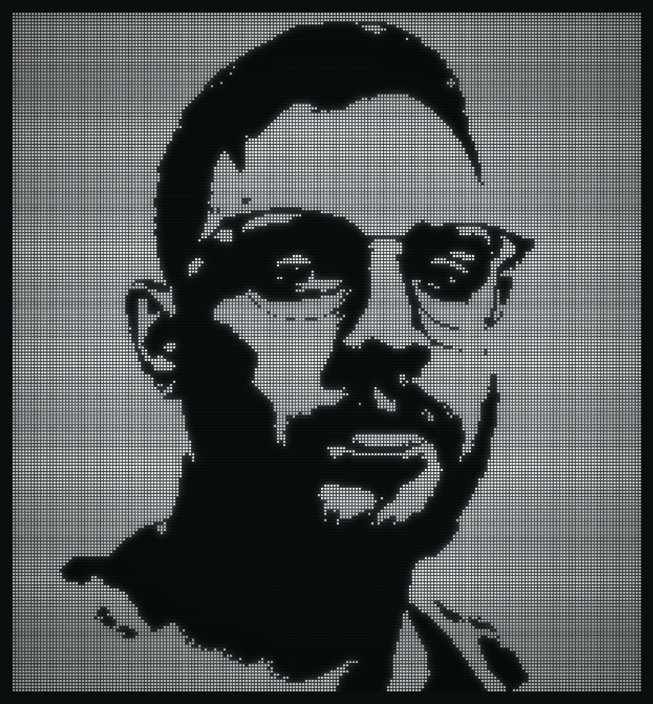
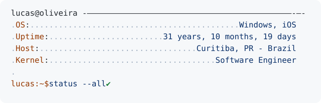

  

    

  <picture>
    <source media="(prefers-color-scheme: dark)" srcset="https://raw.githubusercontent.com/lcosbr/lcosbr/main/dark_mode.svg">
    
  </picture>

    

  
  
  
  
  
  
  
  

    

### 📫 Connect with Me

- ✉️ **Email**: [lcosbr@live.com](mailto:lcosbr@live.com)
- 💼 **LinkedIn**: [linkedin.com/in/lcosbr](https://linkedin.com/in/lcosbr)
- 📍 **Location**: Curitiba, PR — Brazil
